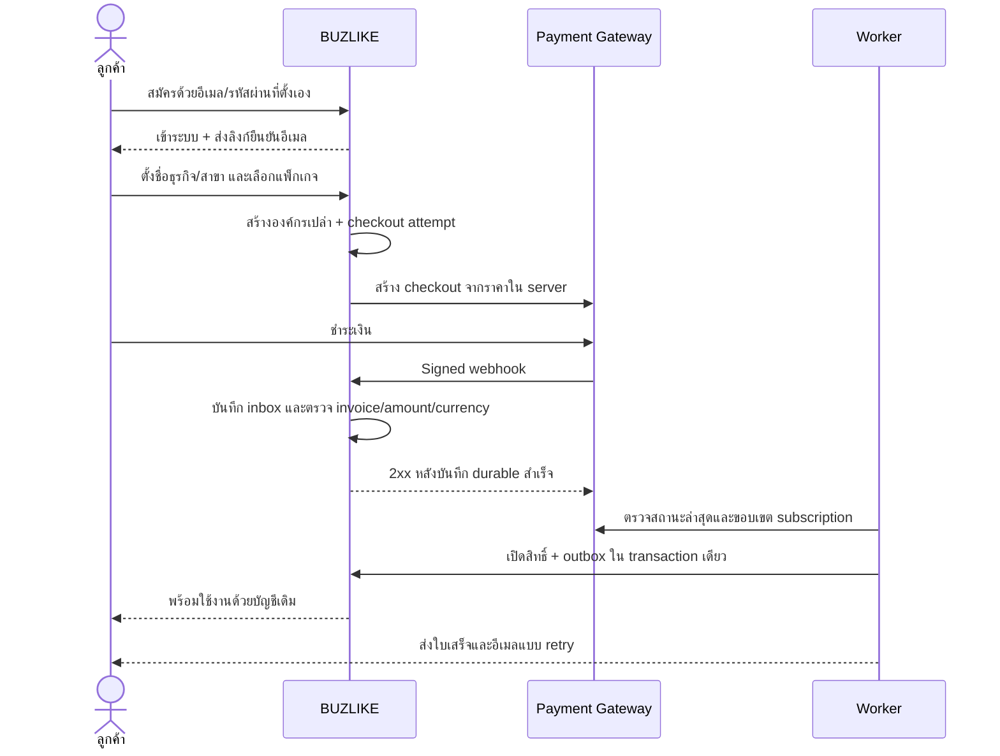
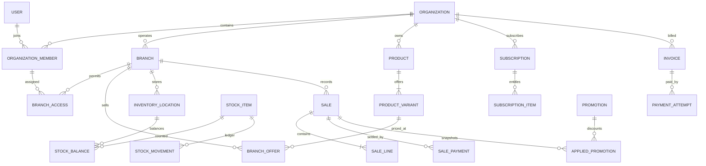

# BUZLIKE POS v2 — วิเคราะห์ใหม่และแบบระบบ

วันที่: 5 พฤศจิกายน 2026

ปรับปรุง UX 6 พฤศจิกายน 2026: ใช้ [แผนสมัครและตั้งร้าน](../signup-onboarding-ux-plan.md) ร่วมด้วย สมัครถามเฉพาะ email/password/confirmation; ตั้งร้าน 2 ขั้นตอน ไม่ให้ผู้ใช้กำหนด slug และไม่บังคับข้อมูลพร้อมเพย์/ภาษีก่อนเริ่ม

## สถานะและขอบเขต

ข้อกำหนดล่าสุดของเจ้าของผลิตภัณฑ์คือ Self-service SaaS: ลูกค้าสมัคร ตั้งรหัสผ่าน ชำระเงิน และใช้งานเองได้ ร้านเริ่มจากข้อมูลเปล่า รองรับหลายธุรกิจและหลายสาขา ส่วนองค์กรที่ต้องปรับระบบติดต่อทีมโดยตรง เอกสารนี้ใช้แทนข้อกำหนดเดิมเฉพาะประเด็นที่ขัดกัน โดยเฉพาะการเติมข้อมูลตัวอย่าง สิทธิ์รายสาขา และวงจรสมาชิกอัตโนมัติ

เอกสารนี้เป็นแบบสำหรับพัฒนารุ่นถัดไป ไม่ใช่รายงานว่าฟังก์ชันทั้งหมดทำเสร็จแล้ว แบบฐานข้อมูลที่รันตรวจสอบได้อยู่ที่ [pos-saas-v2.sql](./pos-saas-v2.sql) และ **ไม่ได้ migrate ทับฐานข้อมูลของแอปปัจจุบัน**

สิ่งที่แก้ในแอปครั้งนี้: สมัครร้านใหม่สร้างเฉพาะร้าน สาขาหลัก และเจ้าของร้าน ไม่สร้างสินค้า หมวดหมู่ วัตถุดิบ โต๊ะ หรือยอดขายตัวอย่าง; ให้เจ้าของตั้ง PIN เอง และพาไปเพิ่มสินค้า ตัวอย่างเดิมใช้เฉพาะ demo/test

## 1. ผลตรวจระบบปัจจุบัน

| ประเด็น | หลักฐานในโค้ด | ผลต่อการออกแบบใหม่ |
|---|---|---|
| บัญชีเดียวเป็นเจ้าของหลายร้านได้ | `User.ownedTenants`, onboarding จำกัด 5 ร้าน | ใช้ User เป็นบุคคล และ Tenant เป็นองค์กรธุรกิจ แยกจาก Branch; ไม่สร้างบัญชีซ้ำทุกสาขา |
| มีตารางสาขาและ API เลือกสาขาแล้ว | `StoreBranch`, `branchId` ใน API v1, ตัวเลือกสาขาใน UI | เก็บส่วนที่ใช้ได้ ปรับการตรวจสิทธิ์ให้ครอบคลุมทุก API/realtime/export/offline |
| พนักงานมี role เดียวต่อ Tenant | `StaffMember.role`; `context()` คืนทุกสาขาที่ active | ต้องแยกสมาชิกองค์กรกับสิทธิ์รายสาขา พนักงานสาขา A ไม่ควรอ่านสาขา B ได้ |
| สต็อกรายชิ้นยังอยู่ที่สินค้า | `Product.directStockQty`, `stock-deduction.ts` | เปลี่ยนเป็นยอดต่อ location/สาขา และ ledger เดียวสำหรับสินค้าและวัตถุดิบ |
| วัตถุดิบแยกสาขาแล้ว | `BranchIngredientStock` | ย้ายเข้าระบบ inventory เดียว โดยรักษาประวัติเดิม |
| Tenant ID มีหลายตาราง แต่ FK ยังอ้าง ID เดี่ยว | `Order.shiftId`, `OrderItem.productId`, `RecipeBomItem.ingredientId` | ใช้ composite FK บังคับองค์กร/สาขาตรงกันใน DB เพิ่มจากการกรองใน API |
| Stripe checkout/webhook เปิดสิทธิ์ได้ | checkout, webhook, `activatePayment()` | เสริม billing lifecycle, event replay/reordering, reconcile, cancellation portal และ tests จาก provider |
| โอนแนบสลิปต้องรอแอดมิน | API billing slip + superadmin | ถอดออกจากเส้นทางสมัครอัตโนมัติ ใช้ gateway-confirmed payment เป็นเส้นทางหลัก |
| Promotions ปัจจุบันเป็นส่วนลดในบิล | `Order.discountAmount`, `discountReason`; ไม่มี Promotion model | เพิ่มแคมเปญ เงื่อนไข ช่วงเวลา สาขา/สินค้าเป้าหมาย และ usage limit ที่ทนการขายพร้อมกัน |
| เข้าระบบพาไปร้านแรก | `/start` ใช้ `findFirst` | ทำหน้ารายการธุรกิจและสาขาที่มีสิทธิ์ จำตัวเลือกครั้งล่าสุด |
| ระบบทดลองเคยเติมข้อมูลตัวอย่าง | `seedTenantTemplate()` | แก้ production onboarding ให้เปล่าแล้ว; แยก demo จากบัญชีจริง |
| กู้รหัสผ่าน/ยืนยันอีเมล/คำเชิญยังไม่มี | auth routes และ User model | เป็นงานจำเป็นของ self-service ไม่ใช่งานเสริม |

## 2. สินค้าเดียว รองรับหลายรูปแบบร้าน

ใช้แกน POS เดียว แล้วเปิดหน้าจอตาม business profile และโมดูลที่ลูกค้าเลือก ไม่ทำฐานข้อมูลคนละชุดต่อประเภทร้าน และไม่บังคับร้านค้าปลีกเห็นโต๊ะ/จอครัว

| กลุ่ม | การเริ่มใช้งาน | โมดูลที่ตอบโจทย์ |
|---|---|---|
| ร้านเล็ก / รถเข็น / ค้าปลีก | สมัครเอง ตั้งร้าน เพิ่มสินค้า เริ่มขาย | POS, บาร์โค้ด, สินค้า/ตัวเลือก, ส่วนลดพื้นฐาน, สต็อก, กะ, ใบเสร็จ, รายงาน |
| คาเฟ่ / เบเกอรี่ / ร้านอาหาร | สมัครเอง เลือกเปิดโต๊ะ/ครัว/สูตรตามต้องการ | modifiers, BOM, KDS, QR ordering, โต๊ะ, รอบขาย, ต้นทุน |
| ร้านขนาดกลาง / หลายสาขา | สมัครเอง สร้างสาขาภายในสิทธิ์ เชิญทีม | รายงานรวม/รายสาขา, ราคาต่างสาขา, promotions, CRM, สิทธิ์รายสาขา, โอนสต็อก, จัดซื้อ |
| ร้านใหญ่ / เครือร้าน / Franchise | ส่งคำขอ Enterprise ติดต่อทีม | การเชื่อมต่อเฉพาะ, SSO, SLA, data migration, load tuning, ข้อมูลแยก deployment ตามข้อตกลง |

ขนาดร้านใช้ความซับซ้อนของงาน จำนวนสาขา/เครื่อง/ผู้ใช้ และ peak orders ประกอบกัน ไม่ใช้คำว่า “ร้านใหญ่” เป็นเหตุให้บังคับติดต่อทีมเสมอ หาก Pro ตอบโจทย์อยู่แล้วให้ซื้อเองได้ บริการนัดหมาย/ซ่อม/เช่าเป็นโมดูลอนาคต ไม่โฆษณาว่ารองรับทุกธุรกิจตั้งแต่รุ่นแรก

Enterprise ใช้ core code เดียว เปิดความสามารถด้วย config/integration และ entitlement ไม่ fork ระบบรายลูกค้า เว้นแต่มีเหตุผลด้าน isolation ที่ตกลงชัดเจน

## 3. เส้นทางสมัครและชำระเงินที่ไม่ต้องใช้แอดมิน

กติกา:

1. ใช้อีเมลเป็น username เจ้าของตั้ง password เอง ไม่สร้างรหัสผ่านใหม่หลังชำระเงิน ไม่ส่ง password ทางอีเมล
2. เปิดทดลองฟรี 14 วันเป็นทางเลือก หรือซื้อทันทีได้ การเลือกแพ็กเกจจาก landing ต้องคงอยู่ผ่านสมัคร/login/onboarding และกลับเข้า checkout เดิมได้
3. องค์กรเริ่มมีเพียงเจ้าของและสาขาแรก ยอดขาย/สต็อกเป็นศูนย์ ชื่อสาขาแก้ได้ ประเภทธุรกิจกำหนดโมดูลที่แนะนำ ไม่เติมแคตตาล็อกอัตโนมัติ
4. การใช้ trial, checkout, การชำระแล้ว และ onboarding progress เป็นคนละสถานะ ไม่ใช้ `User.isPaid` หรือเปิดสิทธิ์ทุกธุรกิจของ User เมื่อจ่ายธุรกิจเดียว
5. บัตรรองรับต่ออายุอัตโนมัติ; PromptPay ผ่าน gateway รับผลอัตโนมัติ แต่ลูกค้าต้องสแกนใหม่แต่ละงวด ไม่เรียกว่าหักบัญชี PromptPay อัตโนมัติ
6. QR พร้อมเพย์ธรรมดาที่สร้างเองไม่ได้พิสูจน์เงินเข้า ช่องทางค่าสมาชิกหลักต้องมี callback ที่ตรวจสอบได้ ไม่ใช้รูปสลิปเป็นหลักฐานเปิดสิทธิ์ทันที
7. หน้ากลับจาก checkout แสดง “กำลังยืนยัน” และถามสถานะ server; ห้ามเปิดสิทธิ์จาก `?success=1` อาจตรวจ session ฝั่ง server ผ่าน service เดียวกับ webhook เพื่อให้เร็วขึ้น
8. ปิดหน้าเว็บหลังจ่ายก็ต้องเปิดสิทธิ์ได้; webhook ซ้ำหรือ worker retry ห้ามต่ออายุซ้ำ; events มาสลับลำดับต้องไม่ทำบัญชีที่จ่ายแล้วกลายเป็นหมดอายุ
9. สำเร็จแล้วเปิดสิทธิ์ก่อนส่งอีเมล SMTP ล่มต้องไม่ขัดขวางการใช้งาน มี retry และแจ้งเตือนระบบเมื่อผิดปกติ
10. สมัคร/ยืนยันอีเมล/กู้รหัสผ่าน/เชิญพนักงาน/เปลี่ยนแพ็กเกจ/ยกเลิก/ดาวน์โหลดข้อมูลทำเองได้ รองรับ token แบบ hash, ใช้ครั้งเดียว, หมดอายุ และ rate limit
11. ยกเลิกต่ออายุยังใช้ได้ถึงวันสิ้นงวด; downgrade มีผลรอบถัดไป หากเกินโควตาต้องให้เลือกลดสาขา/เครื่องก่อน ไม่ลบข้อมูล; upgrade แสดงยอดเพิ่มก่อนยืนยัน
12. ไม่มีแอดมินอนุมัติบัญชีตามปกติ ทีมแพลตฟอร์มเกี่ยวข้องเฉพาะเหตุผิดปกติ support และ Enterprise

การสร้างบัญชี merchant, ผ่านเงื่อนไข gateway, ตั้ง keys/HTTPS/webhook/SMTP เป็นการตั้งค่าระบบของผู้ให้บริการครั้งแรก ไม่ใช่งานที่ต้องทำให้ลูกค้าแต่ละราย

## 4. ราคาและความสามารถ

คงราคาที่ผู้ใช้กำหนด: Starter 199/เดือน หรือ 1,990/ปี; Pro 499/เดือน หรือ 4,990/ปี (ราคาปกติสำหรับทุกคน ตามที่อนุมัติ 11 พ.ย. 2026; แยกจากสิทธิ์นำร่อง 5 ธุรกิจใช้ฟรี 30 วัน) คงขอบเขตปัจจุบัน Starter 1 สาขา / Pro สูงสุด 3 สาขา **ไม่เปลี่ยนเป็นราคาต่อสาขาโดยเงียบ ๆ** ราคาสาขาเพิ่มและ Enterprise ต้องแสดงแยกก่อนซื้อ ระบบฐานข้อมูลรองรับ quantity/add-on แต่ยังไม่เปิดขายจนผ่านการคำนวณต้นทุน

ตารางนี้คือ **เป้าหมายของ v2**; ฟีเจอร์ใหม่ เช่น promotions/CRM/stock transfer ยังไม่ใช่ฟีเจอร์ที่แอปเดิมทำครบแล้ว

| ความสามารถ | Starter | Pro | Enterprise |
|---|---|---|---|
| ขาย/กะ/ใบเสร็จ/สินค้า/บาร์โค้ด/CSV | มี | มี | มี |
| สต็อกต่อสาขาและประวัติการปรับ | มี | มี | มี |
| ส่วนลดและโปรโมชันเปอร์เซ็นต์/ยอดคงที่ตามช่วงเวลา | มี | มี | มี |
| หลาย SKU/ขนาด/สี และราคาต่างช่องทาง | พื้นฐาน | มี | ปรับได้ |
| KDS/โต๊ะ/QR/BOM | — | เลือกเปิดได้ | เลือกเปิดได้ |
| โปรชุด/ซื้อ X แถม Y/คูปองและเงื่อนไขซ้อน | — | มี | ปรับได้ |
| CRM/คะแนน/สมาชิก | — | มี | ปรับได้ |
| เปรียบเทียบสาขา/ราคาต่างสาขา/โอนสต็อก/จัดซื้อ | — | มี | มี |
| ขอบเขตสิทธิ์พนักงาน | role มาตรฐาน | รายสาขา + approval policy | custom roles/SSO |
| ส่งออกข้อมูลร้านเพื่อย้ายระบบ/ยกเลิกต่ออายุเอง | มี | มี | มี |
| SLA/API integrations/isolated deployment | — | — | ติดต่อทีม |

Trial ทดลองฟีเจอร์ Pro โดยจำกัดปริมาณตามเดิม; รายงาน/ข้อมูลของตัวเองต้องดูและส่งออกได้เมื่อหมดสมาชิกภายใต้นโยบายเก็บข้อมูลที่ประกาศ ส่วน snapshot สำหรับติดตั้ง Self-host เป็นสิทธิ์แยกของ Lifetime

Lifetime เดิมยังคงสิทธิ์ที่ขายไปแล้ว ไม่ควรโฆษณาว่า cloud ฟรีตลอดชีวิตเมื่อมีค่าดูแลหลังปีแรก หน้า checkout ต้องแยกค่าซอฟต์แวร์/โฮสต์/ฮาร์ดแวร์/gateway/ภาษีอย่างตรงไปตรงมา ยอดภาษีควรมาจาก billing configuration ของผู้ขาย ไม่ฝัง 7% ทุกบัญชีโดยไม่มีเงื่อนไข

ราคานี้เป็นราคาซอฟต์แวร์ การตัดสินว่าคุ้มต้องวัดต้นทุนต่อ active branch, payment fees, storage/backup, support hours และ gross margin ก่อนเปิดโควตาเพิ่มเติม ไม่มีเหตุผลพอจะสัญญาไม่จำกัดทุกอย่างในราคาเดียว

## 5. จุดแข่งขันกับ Wongnai

จากเอกสารทางการ คู่แข่งมีหลายสาขา โปรโมชั่น สต็อก การโอนสินค้า และงานร้านอาหารอยู่แล้ว การมี KDS/QR อย่างเดียวจึงยังไม่ใช่หลักฐานว่า BUZLIKE ฟีเจอร์มากกว่า

เป้าหมายที่ควรแข่งขันและทดสอบได้:

| เป้าหมาย | หลักฐานที่ต้องทำให้ได้ |
|---|---|
| เริ่มได้เองเร็ว | ผู้ใช้ใหม่สมัคร → ตั้งร้าน → เพิ่มสินค้าแรก → ขายแรกได้โดยไม่คุยทีม; ทดสอบ usability จับเวลา |
| ตอบโจทย์ทั้งร้านอาหารและค้าปลีก | มี SKU/variants/หน่วยนับ/บาร์โค้ดและหลายสาขาจริง คู่กับโต๊ะ/ครัว/BOM; ไม่ใช้โมเดลอาหารกับทุกธุรกิจ |
| ใช้ง่าย | ซ่อนโมดูลที่ร้านไม่ได้เปิด มี setup checklist/empty state/import preview; วัด task success กับเจ้าของร้านใหม่ |
| ไม่ผูกมัด | ใช้อุปกรณ์ที่รองรับเดิมได้, ยกเลิกเอง, ส่งออกข้อมูลรูปแบบอ่านได้, ไม่มีค่าถอนข้อมูล |
| ราคาชัดเจน | แสดงรวมรายปี สิทธิ์สาขา ค่าเพิ่ม และวันต่ออายุ; เปรียบเทียบ total cost ภายใต้ขอบเขตเดียวกัน |
| ทำงานหลายสาขาถูกต้อง | สต็อก/ราคา/พนักงานแยกจริง รายงานรวมตรงกับผลรวมแต่ละสาขา |

ยังไม่ใช้คำโฆษณา “ดีกว่า/ถูกกว่า/ฟีเจอร์มากกว่าทุกระบบ” จนมีผลเปรียบเทียบราคา ณ วันขายและหลักฐานการใช้งานจริง ไม่อ้างว่ารองรับ LINE MAN/แพลตฟอร์ม delivery หากยังไม่มี API/ข้อตกลง integration

## 6. แบบข้อมูลและขอบเขตความเป็นเจ้าของ

### ขอบเขตสำคัญ

- **User = คน/บัญชีเข้าสู่ระบบ** อีเมล unique แบบไม่แยกตัวพิมพ์ใหญ่เล็ก คนเดียวอยู่ได้หลายองค์กร ไม่มี subscription ผูกตรงกับ User
- **Organization = Tenant = ธุรกิจ/ผู้รับใบเรียกเก็บเงิน** ไม่ใช่สาขา เก็บนโยบายร่วม แคตตาล็อก ลูกค้า และการสมัครสมาชิก; ธุรกิจคนละเจ้าของต้องไม่มีข้อมูลปะปน
- **OrganizationMember = สมาชิกองค์กร** อ้าง User ได้ หรือเป็นพนักงาน PIN ที่ไม่เปิดเว็บหลังบ้าน บัญชีที่เข้าสู่ระบบต้องไม่แชร์ user/password กัน
- **BranchAccess = สิทธิ์รายสาขา** role องค์กร OWNER/ADMIN ดูทุกสาขาได้ ส่วนพนักงานต้องมี assignment; สิทธิ์ที่แท้จริงเป็น intersection ของผู้ login, PIN operator, branch scope และ entitlement ห้าม PIN ขยายสิทธิ์บัญชีที่ไม่มีสิทธิ์ในสาขานั้น
- **Product/Variant = สินค้ากลาง** สินค้าเรียบง่ายมี default variant 1 ตัว ตัวเลือกเพิ่มช็อต/ความหวานแยก Modifier ไม่สร้าง SKU ทุก combination
- **BranchOffer = สินค้าที่ขายในสาขา** ราคาและ availability ต่อ branch/channel ชื่อ/รูปใช้ข้อมูลกลาง; ไม่มี override ให้ fallback อย่างชัดเจน
- **StockItem = หน่วยนับสต็อก** ใช้ได้ทั้งสินค้าสำเร็จรูปและวัตถุดิบ; **StockBalance = คงเหลือต่อ location** ไม่เก็บยอดรวมใน Product
- **StockMovement = ประวัติถาวร** ขาย คืน รับเข้า เสียหาย ปรับ โอน แก้ด้วย reversal ไม่แก้ทับอดีต; write balance และ movement ใน transaction เดียว
- **Subscription / Items = สิทธิ์และจำนวนที่ซื้อ** แยกจาก Invoice / Attempts = สิ่งที่เรียกเก็บและความพยายามชำระ Plan version/price ต้อง immutable ไม่เปลี่ยนใบแจ้งหนี้เก่าเมื่อปรับราคา
- **Retail payments ≠ SaaS payments** เงินที่ลูกค้าหน้าร้านจ่ายเป็นของร้าน เงินค่าสมาชิกเป็นของ BUZLIKE ใช้ตารางและ callback คนละขอบเขต

### ตารางที่ต้องมี

| หมวด | ตารางใน SQL blueprint | หน้าที่ |
|---|---|---|
| Identity/องค์กร | app_user, organization, organization_member, branch, branch_access, identity_token, staff_invitation | คน ธุรกิจ สาขา สิทธิ์ และการตั้งค่าด้วยตัวเอง |
| โมดูล | business_module | เปิดตามประเภทร้านได้ แต่ไม่ให้เกินแพ็กเกจ |
| Billing | plan_version, subscription, subscription_item, billing_invoice, billing_invoice_line, payment_attempt, billing_webhook_inbox | version ราคา/สิทธิ์ งวดบิล ความพยายามจ่าย และ durable callback |
| ความสามารถเฉพาะราย | entitlement_override | สิทธิ์สัญญา Enterprise ที่มีวันหมดอายุและ audit ไม่แก้ราคา global |
| Catalog | category, product, product_variant, branch_offer, modifier_group, modifier_option, product_modifier_group | แคตตาล็อกกลาง/ราคา/ตัวเลือก |
| Inventory | stock_item, inventory_location, stock_balance, stock_movement, recipe_component, stock_transfer, stock_transfer_line | ยอดแยกสาขา สูตร และการโอน |
| Promotions | promotion, promotion_branch, promotion_variant, promotion_redemption | rules แบบมี version, scope, usage และ snapshot |
| Sales | terminal, cashier_shift, sale, sale_line, sale_line_modifier, sale_payment, sale_adjustment, refund, refund_line, cash_movement | การขาย/คืนบางรายการ/ส่วนลด/เงินในกะ |
| Restaurant | dining_zone, dining_table, table_session, kitchen_ticket | โต๊ะ session ที่หมุน QR และจอครัวแยกสถานี |
| CRM/งานเบื้องหลัง | customer, loyalty_entry, audit_event, outbox_job | ข้อมูลลูกค้า ledger คะแนน งานที่ retry และตรวจย้อนหลัง |

SQL เป็น baseline ของโครงสร้าง ไม่ใช่ application implementation: validation rules ของโปร, accounting posting, การส่งอีเมล และการตัดสิทธิ์ต้องเขียน service/tests เพิ่ม ตาราง Supplier/PO/GR, custom role permissions และ API integration จะเพิ่มเป็น migration ใน milestone ถัดไป ไม่เก็บเป็น JSON ก้อนเดียวแทนระบบเหล่านั้น

### กฎฐานข้อมูลที่ต้องรักษา

1. Business rows ต้องมี `organization_id NOT NULL`; ข้อมูลปฏิบัติงานต้องมี branch/location ที่ชัดเจน ใช้ FK แบบ `(organization_id, entity_id)` และ `(organization_id, branch_id, entity_id)` เพื่อป้องกัน ID ข้ามองค์กร/ข้ามสาขาที่ schema เดิมยังไม่บังคับ
2. ใช้ `ON DELETE RESTRICT` กับข้อมูลการขาย/บิล/สต็อก ธุรกิจ/สินค้า/พนักงานใช้ archive ห้าม cascade ล้างประวัติทางการค้า การลบตามอายุข้อมูลต้องผ่านงานเฉพาะที่ตรวจ dependencies และเก็บ audit
3. เงินใช้ integer minor units (`bigint`, สตางค์), ปริมาณใช้ `numeric(18,6)` และหน่วยฐาน/อัตราแปลงที่ตรวจได้ API ส่งยอดใหญ่เป็น string ป้องกัน JavaScript number overflow ห้าม float คิดเงิน
4. วันเวลาใช้ `timestamptz` เก็บ UTC พร้อม timezone และ business-date ของสาขา แยกวันปิดกะข้ามเที่ยงคืน เลขบิล unique ต่อองค์กร/สาขา ไม่ใช้ count+1 ที่ชนกันได้
5. Variant SKU unique ภายในองค์กร; barcode มี index สำหรับค้นหาแต่ไม่บังคับ unique ทั้ง platform; historical sale เก็บ snapshot ชื่อ/ราคา/ภาษี/ตัวเลือก/โปรโมชั่น
6. `sale.client_order_id`, payment-provider reference, webhook event ID, invoice cycle, refund request และ stock operation key มี unique constraint; เมื่อ request ID ซ้ำ hash เนื้อหาต้องตรง มิฉะนั้นตอบ conflict
7. ขายพร้อมกัน lock เฉพาะ balance ของ SKU/location ที่เกี่ยวข้องตามลำดับแน่นอน; ตรวจ quota/โปรโมชั่น/stock และเขียน sale/payment/movement/outbox ใน transaction เดียว ใช้ bounded retry สำหรับ serialization/deadlock ห้าม network call ภายใน DB transaction
8. `stock_balance` เป็น projection ของ ledger ต้อง reconcile ได้ การโอนต่างสาขาใช้ SOURCE → IN_TRANSIT → DESTINATION พร้อมรับจริง/รับบางส่วน ไม่เพิ่มปลายทางตั้งแต่กดส่ง และไม่มีสต็อกลบยกเว้นนโยบายที่อนุญาตชัดเจน
9. โปรโมชั่นประเมิน server จาก rules version ที่เปิดใช้; snapshot ส่วนลดจริงและ allocation ต่อบรรทัด รองรับ priority/stacking/cap, เริ่ม-จบ timezone, quota และคืนคะแนน/usage ตาม refund policy การคิดโปร offline ใช้ snapshot version และส่งตรวจเมื่อ sync
10. DB constraint ตรวจรูปข้อมูลและ FK; กฎข้ามหลาย row เช่น ยอดชำระรวมต้องเท่าบิลหรือยอดคืนสะสมไม่เกินยอดซื้อ ใช้ service transaction/row lock และ integration tests ไม่อ้างว่า CHECK constraint ตัวเดียวพิสูจน์ได้
11. ใช้ RLS เป็นการป้องกันเพิ่มเมื่อ runtime role/context พร้อม: role แอปต้องไม่เป็น superuser/BYPASSRLS/table owner, ตั้ง organization context ด้วย `SET LOCAL` ใน transaction ภายใต้ connection pool, ไม่มี context ต้อง deny; webhook/worker ใช้ role ที่แยกและจำกัดสิทธิ์ SQL blueprint ยังไม่เปิด RLS จึงห้ามนำไปใช้โดยอ้างว่ามี RLS แล้ว
12. Index เริ่มด้วยองค์กร/สาขาสำหรับ query หลัก; pagination ใช้ cursor; tenant context ต้องครอบคลุมไฟล์/export/cache/IndexedDB/realtime topic/object storage signed URL ด้วย ไม่ใช่แค่ SQL

## 7. งานเบื้องหลังและสถานะสมาชิก

เริ่มจาก modular monolith: Next.js/API + PostgreSQL + worker process ที่ deploy แยกได้ + private object storage; Redis ใช้กระจาย realtime/rate limit/cache ไม่เป็นแหล่งความจริงของเงินหรือสต็อก ไม่ต้อง microservices ตั้งแต่เริ่ม

Billing inbox มี unique `(provider, account, event_id)`, payload จำกัดอายุและสิทธิ์อ่าน worker claim งานผ่าน lock/lease; ตรวจ resource ล่าสุดเมื่อ order ของ event ไม่แน่นอน เก็บ processed/failed/retry/attempts ตรวจยอดและ currency จาก invoice snapshot การ reconcile เป็น scheduled job หาเงินจ่ายแล้วแต่สิทธิ์ไม่ตรง, pending ค้าง, invoice ไม่ออก และ email ล้มเหลว

Subscription: `TRIALING → ACTIVE → PAST_DUE → READ_ONLY`; การยกเลิกตั้ง `cancel_at_period_end` โดยยัง ACTIVE ถึง `paid_through`; การระงับด้วยผู้ดูแลแยกจากหมดอายุ; Lifetime แยก license term จาก cloud hosting term; history subscription เก่าอยู่ได้แต่มี live subscription ต่อองค์กรได้เพียงตัวเดียว เมื่อหมดอายุยังดูและนำข้อมูลตัวเองออกได้ตาม retention ที่ประกาศ

Outbox เขียนพร้อมธุรกรรมหลัก ส่งงานแบบ at-least-once พร้อม unique dedup key, lease, exponential retry และ dead-letter ต้องมีหน้า operational status/alert เฉพาะเหตุผิดปกติ จึงลดงานประจำของเจ้าของแพลตฟอร์มได้จริง

## 8. แผนย้ายข้อมูลจากแอปปัจจุบัน

ใช้ expand → backfill → verify → switch → contract ห้าม `migrate reset` หรือ delete ข้อมูลร้านเดิม

1. สำรองและซ้อม restore; inventory สินค้า/branch/paid invoice/order counts และ hash snapshots ก่อนย้าย
2. รักษา Tenant IDs เป็น Organization IDs และ StoreBranch IDs เดิม เพิ่ม membership/branch grants โดยไม่เปิดสิทธิ์เกินเดิม เจ้าของทุกสาขา พนักงานที่เดิมเข้าถึงได้ทุกสาขาต้องให้เจ้าของตรวจ assignment ก่อนเปิด branch restrictions
3. สร้าง default variant ให้สินค้าเดิม branch offer ใช้ราคาเดิม อย่าคูณยอด `directStockQty` ไปทุกสาขา เพราะยอดเดิมไม่ได้บอกว่าอยู่ที่ไหน ให้เจ้าของระบุ opening balance ต่อสาขา; ร้านสาขาเดียวโยกได้ตรง ๆ พร้อม opening ledger
4. วัตถุดิบ/branch stocks → stock items/balances; จัดชนิด ledger สำหรับ movement เดิมที่ซ้ำกับ opening ห้ามนับซ้ำ; order/shift/table/payment references ต้องอยู่ในองค์กรและสาขาเดียวกัน
5. เปลี่ยน Decimal บาทเป็นสตางค์แบบ exact; snapshot invoices/ราคาที่ขายไปแล้ว; payments เดิมไม่อ้างว่าเป็น recurring subscription โดยไม่มี provider resource จริง
6. Backfill order lines/modifiers/refunds/recipes และ audit เก็บ ID mapping; export/import เดิมเพิ่ม schema version และ migration adapter; cache/offline payload เพิ่ม version + organization/branch/terminal ห้ามให้ queue เก่าลงผิดสาขา
7. ไม่ทำ dual-write กระจัดกระจาย เปิดผ่าน repository/service เดียวพร้อม transaction; เทียบยอด shadow read ตามองค์กรก่อน cutover ทีละ cohort; หยุดเขียนช่วงเปลี่ยน authority ตามแผนที่แจ้งไว้
8. ตรวจ counts/FK/stock ledger/bill totals/payments รายองค์กร; rollback ต้องมี reverse adapter หรือ restore snapshot ที่ซ้อมแล้ว ฟีเจอร์ใหม่ที่ย้อนกลับไม่ได้ต้องไม่เปิดก่อนหมด rollback window
9. Contract เอา field เก่าออกเมื่อไม่มี reader/writer/offline client พึ่งพาและตรวจข้อมูลผ่านแล้วเท่านั้น

## 9. ลำดับพัฒนาและเกณฑ์รับงาน

| ลำดับ | ผลส่งมอบ | เกณฑ์ที่ต้องผ่าน |
|---|---|---|
| 0 — ทำในรอบนี้ | แบบระบบ/SQL + ร้านสมัครใหม่เปล่า | DDL สร้างได้ใน schema ชั่วคราว, ทดสอบ FK ข้าม tenant/branch และ constraint สำคัญ; ทดสอบ HTTP onboarding และเพิ่มสินค้าด้วยตัวเอง |
| 1 — ฐานองค์กร/สาขา | membership + branch grants + branch inventory + variants + migration | ผู้ใช้หนึ่งคนหลายองค์กร, พนักงานคนละสิทธิ์แต่ละสาขา, cross-tenant/branch ปฏิเสธทุกช่องทาง, concurrent stock ไม่ติดลบ |
| 2 — self-service lifecycle | plan carry-through, email verification/reset/invite, checkout/status, webhook worker/reconcile, cancellation | สมัคร → จ่าย → ใช้บัญชีเดิมได้โดยไม่แตะ admin; ปิดแท็บ/ซ้ำ/สลับลำดับ callback/SMTP ล่ม/renew/fail/cancel ผ่าน testmode provider |
| 3 — ร้านตั้งค่าเองครบ | import CSV/preview, business modules, promotions v1/v2, role-aware UI, prices | ร้านเปล่าเพิ่มสินค้าหรือ import แล้วขายได้; โปรทับซ้อน/หมดอายุ/โควตาพร้อมกันคิดตรง; Starter/Pro ต่างความสามารถจริง |
| 4 — หลายสาขา/Pro retail | CRM/loyalty, transfers/receive/PO, branch comparison | ราคาและสต็อกแยกจริง การโอน/คืน/คะแนน idempotent ยอดรายงานตรง ledger |
| 5 — เปิดใช้งานจริง | HTTPS/gateway/SMTP/backup/monitoring/runbook/hardware | จ่ายเงินจริง/รับอีเมล/ซ้อม restore/เครื่องพิมพ์จริง; load test ด้วย peak ที่ตกลงและรายงาน p95/error/concurrency ไม่รับรอง scale จากจำนวนตารางหรือ unit tests |

เป้าหมายเชิงวิศวกรรมเบื้องต้น: ไม่มีการปนข้อมูล tenant, ไม่มีเปิดสิทธิ์โดยยังไม่ยืนยันเงิน, ไม่มี duplicate sale/renewal, ไม่มี silent price mismatch/offline overwrite ขนาดที่รองรับจริงต้องวัดจาก workload ของร้านตัวแทนก่อนกำหนด SLA

## แหล่งอ้างอิงที่ตรวจในวันที่ออกแบบ

- [Wongnai: รายการสาขาและสลับสาขา](https://help.wongnai.com/branches-staff/branch-list/) — baseline สาขาและหมวดความสามารถในเอกสารทางการ
- [Wongnai POS](https://www.wongnai.com/pos/) — กลุ่มรูปแบบร้านและบริการปัจจุบัน; ไม่ใช้ราคาโปรเก่าแทนราคาขายจริง
- [Stripe: Fulfill orders](https://docs.stripe.com/checkout/fulfillment) — เปิดบริการจาก webhook และทำ fulfillment ซ้ำได้โดยไม่มีผลซ้ำ
- [Stripe: Webhooks](https://docs.stripe.com/webhooks) — signed events, retries และ event ordering
- [Stripe: PromptPay](https://docs.stripe.com/payments/promptpay) — confirmation และข้อจำกัดของ Checkout subscription mode / customer-initiated recurring invoice
- [PostgreSQL 17: Constraints](https://www.postgresql.org/docs/17/ddl-constraints.html) — composite foreign keys และข้อจำกัด CHECK
- [PostgreSQL 17: Row security](https://www.postgresql.org/docs/17/ddl-rowsecurity.html) — role bypass และ tenant isolation ที่ต้องตั้งให้ถูก
