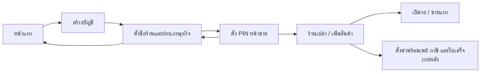

# แผนปรับประสบการณ์สมัครและเริ่มใช้งาน BUZLIKE POS

วันที่ 6 พฤศจิกายน 2026 — ใช้ร่วมกับ `architecture/pos-saas-v2.md` และแทนข้อกำหนดสมัครเดิมที่ขัดกัน

ข้อกำหนดเพิ่มเติมจากผู้ใช้: ออกแบบ **mobile first, tablet และ desktop** ค้นแนวทางปัจจุบันก่อนออกแบบ ทดสอบผ่านเบราว์เซอร์ด้านขวาของ Codex และใช้แป้นตัวเลขสำหรับ PIN ไม่เปิดหน้าต่างเบราว์เซอร์ภายนอกเพื่อส่งมอบงาน

## 1. ผลลัพธ์ที่ผู้ใช้ต้องได้

เจ้าของร้านที่ไม่รู้ศัพท์เทคนิคต้องสร้างบัญชี เข้าระบบ ตั้งร้านเปล่า และเพิ่มสินค้าแรกได้ด้วยตัวเอง ไม่ต้องตั้งรหัส URL ไม่ต้องเปิดเผยชื่อบุคคล/เบอร์โทรก่อนทดลอง และไม่ต้องรอผู้ดูแลระบบ

แยกให้ออกระหว่าง **สร้างบัญชี** (เข้าระบบด้วยอีเมล/รหัสผ่าน), **สร้างธุรกิจ** (ชื่อร้าน/ประเภทร้าน), **ตั้งเครื่องขาย** (PIN พนักงาน), **ตั้งค่ารับเงินลูกค้าหน้าร้าน** และ **จ่ายค่าสมาชิก BUZLIKE** ห้ามใช้ข้อความหรือ QR ที่ทำให้เข้าใจว่าสองการชำระเงินนี้คือเรื่องเดียวกัน

## 2. วิเคราะห์ปัญหาจากโค้ดเดิม

| ปัญหา | ผลกระทบ | การแก้ที่ตรงสาเหตุ |
|---|---|---|
| สมัครขอชื่อเต็มและเบอร์โทรทั้งที่ยังไม่จำเป็น | เพิ่มภาระและขอข้อมูลส่วนตัวเกินเส้นทางทดลอง | ตัดทั้ง UI และ API ไม่แค่ซ่อนช่อง; ข้อมูลใบกำกับภาษีถามตอนลูกค้าขอเอกสาร |
| ไม่มีปุ่มกลับที่อ่านออก | ผู้ใช้ต้องเดาโลโก้หรือใช้ browser back | แสดง “กลับหน้าแรก” ในสมัคร/login/ขั้นแรกของตั้งร้าน; ขั้นต่อไปมี “ย้อนกลับ” |
| รหัสผ่านช่องเดียว | พิมพ์ผิดแล้วไม่ทราบจน login ครั้งถัดไป | ยืนยันรหัสผ่าน + เปิดดูได้ + ตรวจสองฝั่ง ไม่เก็บค่ารหัสยืนยัน |
| บังคับตั้ง `storeSlug` เป็นภาษาอังกฤษ | ผู้ใช้ไม่รู้ความหมาย/รูปแบบ/ความเกี่ยวข้องกับชื่อร้าน | สร้างลิงก์โดย server ไม่ถามศัพท์ URL หรือบังคับแปลงชื่อไทย |
| ต้องเตรียมพร้อมเพย์/ภาษีก่อนมีสินค้า | ขัดเส้นทางทดลองและทำให้สับสนกับจ่ายค่าสมาชิก | ย้ายไปตั้งค่าร้านภายหลัง เริ่มโดยไม่คิด VAT และยังไม่มีพร้อมเพย์ |
| PIN ไม่อธิบายว่าแยกจาก password | อาจใช้รหัสผิดตอน login/สลับพนักงาน | ระบุหน้าที่ของ PIN และรูปแบบตัวเลข 4–6 หลัก |
| ข้อความบอกแก้ชื่อร้านภายหลัง แต่ settings แก้ได้เพียงชื่อสาขา | ผู้ใช้แก้ชื่อที่พิมพ์ผิดไม่ได้ | เพิ่มชื่อธุรกิจใน settings ของ OWNER โดยคง slug เดิม |
| สมัครสำเร็จแต่ auto-login ล้มเหลวอาจส่งสมัครซ้ำ | เจออีเมลซ้ำ ทั้งที่บัญชีถูกสร้างไปแล้ว | จำสถานะสร้างบัญชีสำเร็จในหน้า ให้ retry login ด้วยบัญชีเดิม |
| เอกสาร UI/API ไม่ตรงกัน | รอบพัฒนาถัดไปนำ flow ที่มีปัญหากลับมา | อัปเดต SRS, README, แบบ DB และหลักฐานทดสอบร่วมกัน |

## 3. Flow ใหม่ที่ลงมือแก้รอบนี้

### หน้าสร้างบัญชี

| ช่อง/ปุ่ม | พฤติกรรมและเหตุผล |
|---|---|
| กลับหน้าแรก | ลิงก์ไป `/` แบบแน่นอน ใช้ได้แม้เข้าหน้าสมัครโดยตรง ไม่เดาว่า history ก่อนหน้าคืออะไร |
| อีเมล | ใช้ login; trim และ normalize เป็นตัวพิมพ์เล็ก ตรวจรูปแบบทั้ง UI/API |
| รหัสผ่าน | อย่างน้อย 10 ตัวอักษรตามนโยบายเดิม สูงสุด 128 ไม่ trim รหัสผ่านเงียบ ๆ รองรับ paste/password manager |
| ยืนยันรหัสผ่าน | จำเป็นและต้องตรงกันทุกตัว แจ้งใต้ช่องและ focus ไปแก้ ไม่ยิง API เมื่อหน้าเว็บตรวจพบว่าไม่ตรง |
| แสดงรหัสผ่าน | checkbox สลับการแสดงทั้งสองช่อง เริ่มต้นซ่อน มี label ใช้กับ keyboard ได้ |
| สร้างบัญชี | ระหว่างส่ง disable ปุ่ม; ผิดพลาดคงค่าที่กรอกไว้; สำเร็จใช้ credentials เดิม auto-login |
| มีบัญชีแล้ว/เข้าสู่ระบบ | เป็นทางออกสำหรับผู้ใช้เก่าและกรณีอีเมลซ้ำ ไม่ต้องสร้างบัญชีใหม่ |

API เก็บเฉพาะ email และ password hash ไม่เก็บ password/confirmPassword และไม่รับชื่อ/โทรศัพท์เพื่อบันทึก `User.fullName` ใน schema ปัจจุบันยังเป็น required จึงใช้ label ของบทบาท “เจ้าของร้าน” ไม่ใช่ชื่อบุคคลที่แอบเก็บมา รุ่น DB v2 ให้ชื่อโปรไฟล์เป็น optional; ไม่ลบข้อมูลของบัญชีเก่ารอบนี้

ผู้ที่ login อยู่แล้วเข้า `/register` หรือ `/login` จะไป `/start` ไม่แสดงฟอร์มซ้ำ หน้าแรกและหน้าแพ็กเกจแสดง “ตั้งร้านต่อ” เมื่อยังไม่มีร้าน, “ไปที่ร้านของคุณ” เมื่อมีร้านเดียว หรือ “เลือกร้านของคุณ” เมื่อมีหลายร้าน เมนูและ CTA ใช้สถานะจาก server ร่วมกัน ดูผลตรวจทั้งเส้นทางใน [รายงานตรวจบัญชี](account-journey-audit.md)

### ตั้งร้านขั้นที่ 1: ข้อมูลร้าน

- ถามชื่อร้านและประเภทธุรกิจเท่านั้น รองรับชื่อภาษาไทย/ชื่อซ้ำข้ามธุรกิจ ตรวจชื่อที่มีแต่ช่องว่างตั้งแต่หน้าฟอร์ม
- อธิบายว่าชื่อปรากฏบนหน้าขายและใบเสร็จ ไม่เกี่ยวกับรหัสผ่าน และแก้ภายหลังได้
- ไม่แสดงช่อง slug, URL pattern, reserved words หรือข้อบังคับให้ใช้ชื่ออังกฤษ
- Server สร้าง `shop-<random UUID>` ที่ unique เมื่อสร้าง Tenant; ID ร้านและชื่อที่มนุษย์อ่านเป็นคนละเรื่อง
- “กลับหน้าแรก” ไม่ลบบัญชีที่สร้างไปแล้ว ผู้ใช้ login ภายหลังผ่าน `/start` แล้วกลับมาตั้งร้านได้

### ตั้งร้านขั้นที่ 2: PIN หน้าขาย

- แสดงชื่อร้านสรุปให้ตรวจ พร้อมอธิบายร้านเริ่มจากข้อมูลเปล่า
- PIN ตัวเลข 4–6 หลัก มีแสดง/ซ่อน และบอกว่าใช้สลับผู้ขาย ไม่ใช่รหัส login
- PIN ใช้แป้นปุ่ม 0–9 พร้อมลบตัวล่าสุด/ล้างทั้งหมด มีช่องปิดบัง 6 ตำแหน่ง ปุ่มอย่างน้อย 56px กดได้ด้วยนิ้วหรือ keyboard โดยไม่เรียกคีย์บอร์ดโทรศัพท์ ปุ่มสร้างร้านยังใช้ไม่ได้จนกรอกครบขั้นต่ำ
- ตั้ง PIN แล้วต้องกดซ้ำในขั้นยืนยัน หากไม่ตรงต้องไม่สร้างร้าน ทั้ง UI และ API ตรวจตรงกัน ไม่ส่งอัตโนมัติเพียงเพราะกดครบ 6 หลัก
- ใช้คอมโพเนนต์ PIN เดียวกันในตั้งร้าน สลับพนักงาน และหน้าตั้ง PIN พนักงาน เพื่อรักษาขนาดปุ่ม/พฤติกรรมให้เหมือนกัน
- ย้อนกลับไปแก้ชื่อ/ประเภทธุรกิจได้โดยข้อมูลใน wizard ยังอยู่; ระหว่าง submit ปิดปุ่มสร้าง/ย้อนกลับเพื่อกันกดซ้ำในหน้าเดียว
- กดสร้างแล้วไป Products ที่ไม่มีข้อมูลตัวอย่าง พร้อมคำแนะนำเพิ่มหมวดหมู่/สินค้า
- พร้อมเพย์และ VAT ตั้งค่าในร้านภายหลังได้ ค่าปริยายไม่คิด VAT ไม่สร้างข้อมูลบัญชีรับเงินสมมุติ

### ตั้งค่าร้านภายหลัง

- OWNER แก้ชื่อร้านได้ แยกจากชื่อสาขาอย่างชัดเจน
- เปลี่ยนชื่อไม่เปลี่ยน Tenant ID, slug, สมาชิก, subscription หรือข้อมูลการขาย
- API ตรวจสิทธิ์ OWNER และ tenant context เช่นเดิม; บันทึกชื่อร้าน/ข้อมูลสาขาใน transaction เดียว

## 4. สัญญา API และผลต่อข้อมูล

| Endpoint | ข้อมูลใหม่ | สิ่งที่ต้องรักษา |
|---|---|---|
| `POST /api/auth/register` | email, password, confirmPassword | ตรวจตรงกันก่อน hash/insert; return ID เท่านั้น; email unique; same-origin/rate limit |
| `POST /api/onboarding` | name, businessType, pin, confirmPin | PIN ต้องตรงกัน; slug สร้างใน server; defaults พร้อมเพย์ว่าง/VAT NONE; transaction สร้าง tenant/branch/owner พร้อมกัน |
| `POST /api/v1/:store/settings` | เพิ่ม storeName แบบ optional | payload เดิมยังใช้ได้; เปลี่ยนชื่อเฉพาะ tenant ที่มีสิทธิ์; slug ไม่เปลี่ยน |

ไม่ต้อง migration ของ schema แอปในรอบนี้ ไม่ reset ข้อมูลเก่า ไม่เปลี่ยน slug ร้านเดิม API รุ่นเดิมที่ส่ง fullName/phone จะไม่ถูกนำค่าพวกนั้นไปเก็บ; API สมัครที่ไม่ส่ง confirmPassword ต้องได้รับ 400 ตามสัญญาใหม่

คำตอบผิดพลาดที่จำเป็น: ข้อมูลไม่ครบ/รหัสไม่ตรง 400, อีเมลซ้ำ 409, ยังไม่ login 401, เข้าร้านคนอื่น 403, ถี่เกิน 429 และ failure ของระบบต้องเป็นข้อความที่ผู้ใช้ทำต่อได้ ไม่ dump stack/ข้อมูลลับ

## 5. แผนงานต่อเนื่อง แยกจากสิ่งที่เสร็จรอบนี้

ลำดับนี้ใช้ผลส่งมอบและเงื่อนไขรับงานเป็นตัววัด ไม่สรุปว่าเสร็จจากจำนวนหน้า/จำนวนตาราง และไม่กำหนดเวลาส่งที่ยังไม่ได้ประเมินงานเชื่อมต่อจริง

| งาน | รายการลงมือทำ | ขึ้นกับ | เกณฑ์รับ |
|---|---|---|---|
| A — ลดภาระสมัคร/ตั้งร้าน (รอบนี้) | ฟอร์มขั้นต่ำ, confirm password, navigation, auto slug, 2-step setup, rename store, tests/docs | ระบบ auth/tenant ปัจจุบัน | ทดสอบตามตารางในข้อ 6 ผ่าน; เริ่มร้านเปล่าได้โดยไม่กรอกชื่อบุคคล/เบอร์/slug |
| B — ฟื้นการทำงานเมื่อสะดุด | draft เฉพาะชื่อร้าน/ประเภทธุรกิจ, resume หลัง refresh, request ID + payload hash ป้องกันสร้างร้านซ้ำข้าม retry/tab, focus error summary | A + persistence ที่เหมาะสม | refresh/network timeout/retry ไม่สร้างร้านซ้ำ ไม่บันทึก password/PIN ลง storage |
| C — บัญชีแบบ self-service ครบ | email verification/resend, reset password ใช้ token hash ครั้งเดียว, expiry/rate limit, invalidate session ตาม policy | SMTP/worker + แบบ identity v2 | ผู้ใช้กู้บัญชีเองได้; token ซ้ำ/หมดอายุ/ปลอมใช้ไม่ได้; ไม่แสดงลิงก์หรือปุ่มที่ยังทำงานไม่ได้ |
| D — ซื้อแพ็กเกจจบเอง | เลือก trial หรือซื้อ, คง plan intent ผ่านสมัคร/login/setup, invoice/checkout, status polling, signed webhook/worker/reconcile, receipt | identity/context + provider configuration | จ่ายแล้วใช้บัญชีเดิมได้แม้ปิดแท็บ; callback ซ้ำ/สลับลำดับไม่เปิดสิทธิ์ซ้ำ; gateway fail ไม่บอกว่าสำเร็จ |
| E — พาร้านเปล่าไปขายแรก | checklist แยกร้านอาหาร/ค้าปลีก, import CSV preview/แก้แถวผิด, add category/product/stock, open shift, receipt preview | tenant/catalog permissions | ผู้ใช้ใหม่ทำงานหลักเองได้; ไม่มี sample สต็อกปน; ร้านค้าปลีกไม่ต้องตั้งโต๊ะ/ครัว |
| F — ธุรกิจ/สาขา/ทีม | business picker, branch permissions, variant/stock ต่อสาขา, invite staff, entitlements/quotas | migration ตาม v2 | ไม่มีข้าม tenant/branch ใน API, realtime, export, cache และ offline |
| G — พร้อมรับลูกค้าจริง | provider live E2E, mobile/accessibility, hardware print, logs/alerts, backup/restore, load test | A–F + infrastructure | รายงานผลจริง แยกผลทดสอบ local/testmode/live ไม่เรียกว่า production ready จาก build ผ่านอย่างเดียว |

P0 ก่อนเปิดรับสมาชิกจริง: A, C, D และ isolation ใน F รวมกับ deployment/backup ที่พิสูจน์แล้ว งาน B ต้องทำก่อนเพิ่มช่องทางเริ่มร้านที่เกิด retry/หลายอุปกรณ์จำนวนมาก E ช่วยลด support และการเลิกใช้งาน ส่วน advanced CRM/โปร/จัดซื้อยังอยู่ใน roadmap v2 เดิม

## 6. เกณฑ์ทดสอบรอบนี้

### API/ข้อมูล

| กรณี | ผลที่ต้องได้ |
|---|---|
| สมัครโดยไม่ส่งชื่อและโทรศัพท์ | 201, phone ว่าง, ไม่มีการเก็บชื่อส่วนบุคคล |
| ยืนยันรหัสหาย/ไม่ตรง | 400 และไม่สร้าง User |
| อีเมลมีช่องว่าง/ตัวพิมพ์ใหญ่ | เก็บ normalized email; login และ duplicate check ใช้บัญชีเดียวกัน |
| รหัสผ่านถูกบันทึก | bcrypt hash เท่านั้น; response ไม่มี hash/password/confirmation |
| อีเมลซ้ำ | 409 และไม่สร้างบัญชีที่สอง |
| สร้างร้านโดยไม่มี slug/พร้อมเพย์/VAT | 201, server-generated slug, VAT 0, ไม่มีข้อมูลตัวอย่าง |
| เปลี่ยนชื่อร้าน | ชื่อเปลี่ยน, slug และ ID เดิม; API คนไม่มีสิทธิ์ใช้ไม่ได้ |
| ระบบ POS เดิม | cash/shift/idempotency/QR/stock/roles/export/pricing/import regression เดิมต้องผ่าน |

### Browser desktop และ mobile

1. เปิด `/register` ตรง ๆ → ปุ่มกลับหน้าแรกทำงาน ไม่ต้องอาศัยประวัติเบราว์เซอร์
2. มีเฉพาะ email/password/confirmation; ช่องแสดงรหัสเริ่มซ่อน สลับแล้วค่าคงเดิม
3. พิมพ์รหัสไม่ตรง → ข้อความติดช่องและ focus กลับให้แก้ ไม่มี registration request จากการกดครั้งนี้
4. แก้แล้วสมัคร → login อัตโนมัติ → onboarding; ไม่มีชื่อเต็ม/เบอร์โทรใน request
5. ตั้งร้านด้วยชื่อไทย → ถัดไป → ย้อนกลับ → ชื่อ/ประเภทคงอยู่ → กลับไปตั้ง PIN ได้
6. PIN ผิดรูปแบบต้องไม่สร้างร้าน; PIN ถูกต้อง → สร้าง → Products 0 รายการ, ไม่มี zone/table/ingredient/order
7. ไม่มีช่อง “รหัสร้าน” หรือบังคับเตรียมพร้อมเพย์/ภาษีใน wizard
8. แก้ชื่อร้านใน settings → save/reload แล้วชื่อใหม่ยังอยู่ URL เดิมใช้ได้
9. ตรวจตาม viewport matrix ในข้อ 8 ไม่จำกัดแค่ 390px/1440px: label/คำแนะนำ/error ไม่ถูกตัด, ปุ่มใช้งานได้, ไม่มี document overflow, keyboard/focus ไปต่อได้
10. เข้าหน้าสมัครตอน login อยู่แล้ว → `/start` → ร้านเดิม/ตั้งร้าน ไม่สร้างบัญชีซ้ำ

หลักฐานและสถานะผลทดสอบบันทึกใน `verification.md`; กรณีใน B–G ที่ยังไม่พัฒนาไม่รวมอยู่ในคำว่า “ทดสอบผ่าน” ของรอบนี้

## 7. ข้อจำกัดที่ต้องพูดตรงกัน

- ปุ่มย้อนกลับใน wizard รักษาข้อมูลระหว่าง step แต่ reload/ออกไปหน้าอื่นยังไม่มี draft recovery; browser back ยังเป็นการย้อน URL ไม่ใช่ประวัติทุก step งาน B จะจัดการส่วนนี้
- รหัสยืนยันช่วยกันพิมพ์ผิด ไม่ใช่ระบบกู้รหัสผ่าน งาน C ยังจำเป็น
- มี UUID slug และ unique constraint แล้ว แต่ยังไม่ใช่ idempotency ของการสร้างร้านเมื่อ response สูญหาย งาน B ต้องมี persistent request key
- ราคา/สิทธิ์แพ็กเกจ และร้านเดิมไม่เปลี่ยนจากงาน UX นี้; schema v2 ยังเป็น blueprint ไม่ได้ migrate ใช้จริง
- เว็บไซต์เปรียบเทียบคู่แข่งหรือประกาศว่าดีกว่าต้องมีหลักฐานแยก ไม่ใช้การลดจำนวนช่องสมัครเป็นข้อพิสูจน์ทั้งหมด

## 8. Responsive และ touch design ที่ใช้จริง

ตรวจแหล่งทางการวันที่ 6 พฤศจิกายน 2026:

- [W3C WCAG 2.2 Target Size Enhanced](https://www.w3.org/WAI/WCAG22/Understanding/target-size-enhanced.html): เป้าหมายระดับ Enhanced 44×44 CSS px ไม่อ้างว่าเป็นข้อขั้นต่ำของทุกระดับ WCAG
- [Android / Material accessibility](https://developer.android.com/develop/ui/compose/accessibility/api-defaults): touch target 48dp เป็นแนวอ้างอิงของแพลตฟอร์ม native ไม่เรียก dp ว่าเท่ากับ CSS px ในทุกอุปกรณ์
- [MDN Responsive Web Design](https://developer.mozilla.org/en-US/docs/Learn_web_development/Core/CSS_layout/Responsive_Design): flexible layout, mobile-first breakpoints และหลายขนาดอุปกรณ์
- [web.dev Macro Layouts](https://web.dev/learn/design/macro-layouts): เริ่มจากลำดับข้อมูลหนึ่งคอลัมน์ แล้วใช้ Grid เมื่อพื้นที่เพียงพอ

การตัดสินใจของระบบเรา: ปุ่มตัวเลขเริ่มที่ 56 CSS px และเพิ่มเป็น 64px เมื่อพื้นที่พอ ปุ่มรอง/ช่องกรอกอย่างน้อย 48px ฟอร์มใช้ตัวอักษร 16px ขึ้นไป ไม่มี fixed height ที่ตัดปุ่มเมื่อจอเตี้ย รองรับ safe-area และการเลื่อนแนวตั้งตามธรรมชาติ

| ช่วง layout | รูปแบบ |
|---|---|
| ต่ำกว่า 680px | แถบแบรนด์สั้น + ฟอร์มหนึ่งคอลัมน์ แป้น PIN เต็มพื้นที่ที่อ่านง่าย ไม่มีแถบการตลาดกินความสูง |
| 680–1023px | Tablet/พื้นที่กว้าง: ขั้น PIN แยกคำอธิบายกับแป้นกดสองคอลัมน์ ฟอร์มสมัครยังมี max-width ไม่ยืดช่องกรอกเต็มจอ |
| 1024px ขึ้นไป | หน้าตั้งร้านใช้แถบแบรนด์ด้านบนและกรอบกลาง หน้าสมัคร/login ยังมีพื้นที่แบรนด์ด้านข้าง ฟอร์มและแป้นกดมีความกว้างควบคุม |

ปรับการจัดวางหน้าตั้งร้าน: ปุ่มย้อนกลับอยู่ด้านบน ตามด้วยข้อความขั้นตอนปัจจุบันเพียงตำแหน่งเดียว เช่น “ขั้นตอน 1 จาก 2: ตั้งค่าร้าน” และบอกสิ่งที่จะทำถัดไปเป็นประโยค ไม่ใช้วงกลมตัวเลขกับชื่อย่อที่อาจดูเหมือนแท็บ ปุ่มถัดไประบุปลายทาง “ถัดไป: ตั้งรหัส PIN” รวมข้อมูลร้านเป็นกลุ่ม และวางปุ่มยืนยันตรงใต้แป้น PIN บนจอกว้าง ปุ่มย้อนกลับใช้ตำแหน่งด้านบนเดียวกันทั้งสองขั้นตอน จอที่สูงไม่เกิน 850px ใช้ระยะกระชับและแป้นสูง 56px เพื่อช่วย tablet แนวนอน

จุดเปลี่ยนมาจากความกว้างที่เนื้อหาต้องใช้ ไม่ใช่การเดาว่าแต่ละ user-agent เป็นโทรศัพท์หรือ tablet ช่วง 679/680 และ 1023/1024 ต้องตรวจขอบ breakpoint ด้วย

| Viewport CSS px | ใช้ตรวจ |
|---|---|
| 320×568, 360×640, 390×844, 430×932 | มือถือเล็ก–ใหญ่ แนวตั้ง |
| 667×375 | มือถือแนวนอน/จอเตี้ย ต้องเลื่อนถึงปุ่มได้ |
| 679×900, 680×900 | จุดเปลี่ยนเป็นสองคอลัมน์ |
| 768×1024, 820×1180 | Tablet แนวตั้ง |
| 1023×768, 1024×768 | Tablet แนวนอน/จุดเปลี่ยน layout ใหญ่ |
| 1280×800, 1440×900 | Desktop |

แต่ละขนาดต้องตรวจ geometry ของแป้น/ปุ่ม, overflow ของ document, การซ้อนกันของคอลัมน์ และภาพจริง ส่วน virtual keyboard/สัมผัสบน hardware iOS/Android จริงยังต้องทดสอบกับอุปกรณ์ ไม่กล่าวอ้างจากการ resize browser ว่าครบแล้ว
